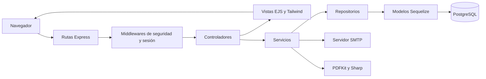
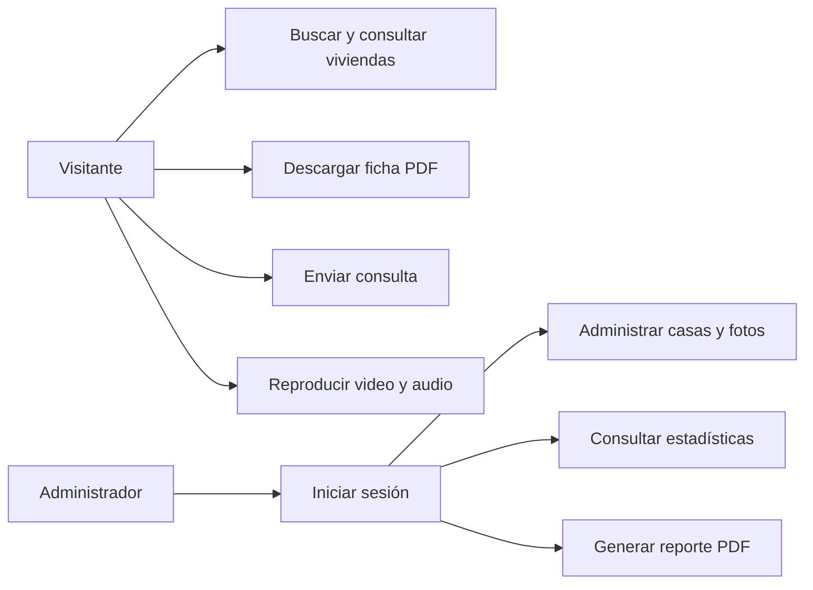

# 2. Diseño y arquitectura

## Arquitectura implementada

Multicasa utiliza MVC. Express recibe las peticiones; los controladores coordinan servicios, los repositorios consultan los modelos Sequelize y las vistas EJS generan HTML. Tailwind proporciona estilos y PostgreSQL almacena usuarios, casas e imágenes. La configuración de base de datos comparte una instancia mediante la caché de módulos de Node.js (Singleton).

## Casos de uso

## Mapa del sitio

| área | Rutas | Acceso |
|---|---|---|
| Inicio e información | `/`, `/compania`, `/servicios`, `/requisitos` | Público |
| Catálogo y ficha | `/casas`, `/casas/:id`, `/casas/:id/ficha.pdf` | Público |
| Contacto y multimedia | `/contacto`, `/video` | Público |
| Inicio de sesión | `/admin/login` | Público |
| Administración | `/admin/casas`, `/admin/dashboard`, `/admin/reporte.pdf` | Sesión de administrador |
| API | `/api/casas`, `/api/casas/:id`, `/api/estadisticas` | Lectura pública de casas; escrituras y estadísticas protegidas |

## Diseño y evidencias

Karla terminó sus tareas el 25/11/2026 según Alondra. La comprobación visual contra el PSD y las capturas de escritorio, tableta y móvil quedan pendientes en la matriz de pruebas. Esta documentación describe la estructura del código; no acredita una revisión visual ya ejecutada.

## Responsabilidades e integración

Karla: diseño y vistas. Michelle: backend, seguridad y API. Erika: datos, búsquedas, mapas y dashboard. Alondra: correo, PDF, multimedia y consolidación documental. Se conservan los contenidos técnicos de Erika en el documento 03 y de Michelle en el 04.
