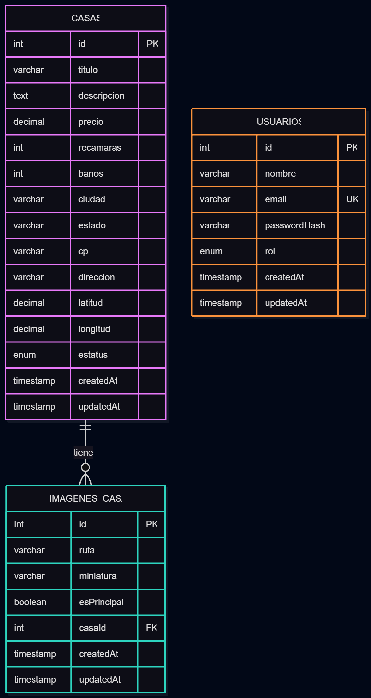

# 3. Modelo físico de la base de datos

**Responsable:** Erika
**Tecnologías:** PostgreSQL 18, Node.js, Express y Sequelize
**Arquitectura:** Modelo-Vista-Controlador (MVC) con capas de servicios y repositorios

## 3.1. Introducción

El sistema web Multicasa utiliza una base de datos relacional implementada en PostgreSQL para almacenar y administrar la información de las propiedades inmobiliarias, sus imágenes y los usuarios administradores.

Para comunicar la aplicación desarrollada con Node.js con la base de datos se utiliza Sequelize, un ORM (Object-Relational Mapping) que permite representar las tablas mediante clases y modelos de JavaScript.

El modelo físico está compuesto por tres tablas principales: `usuarios`, `casas` e `imagenes_casa`.

## 3.2. Objetivo

Diseñar e implementar una base de datos que permita almacenar, consultar, modificar y administrar la información de las propiedades inmobiliarias de Multicasa, garantizando la integridad de los datos y facilitando las búsquedas por ubicación, precio y características de cada vivienda.

## 3.3. Sistema gestor de base de datos

Se utiliza PostgreSQL 18 como sistema gestor de bases de datos relacional.

La base de datos creada recibe el nombre `multicasa` y utiliza las siguientes características:

- Llaves primarias para identificar registros.
- Llaves foráneas para relacionar tablas.
- Restricciones de campos obligatorios.
- Tipos de datos numéricos, de texto, booleanos y enumerados.
- Índices para mejorar las consultas.
- Integración con Sequelize para el acceso y administración de la información.

La base de datos se administra utilizando pgAdmin 4.

## 3.4. Tablas del modelo físico

### Tabla 1. usuarios

Almacena los datos necesarios para autenticar a los administradores del sistema.

| Campo | Tipo de dato | Descripción |
|---|---|---|
| id | SERIAL | Llave primaria |
| nombre | VARCHAR(100) | Nombre del administrador |
| email | VARCHAR(150) | Correo electrónico único y obligatorio |
| passwordHash | VARCHAR(100) | Contraseña almacenada como hash |
| rol | ENUM('admin') | Rol del usuario |
| createdAt | TIMESTAMPTZ | Fecha de creación |
| updatedAt | TIMESTAMPTZ | Fecha de actualización |

Esta tabla permite identificar a los usuarios autorizados para acceder al panel de administración. El modelo actual no define relaciones mediante llaves foráneas con las tablas de propiedades.

### Tabla 2. casas

Es la tabla principal del sistema y almacena las características de las propiedades inmobiliarias.

| Campo | Tipo de dato | Descripción |
|---|---|---|
| id | SERIAL | Llave primaria |
| titulo | VARCHAR(150) | Nombre de la propiedad |
| descripcion | TEXT | Descripción general |
| precio | NUMERIC(12,2) | Precio de la propiedad |
| recamaras | INTEGER | Número de recámaras |
| banos | INTEGER | Número de baños |
| ciudad | VARCHAR(80) | Ciudad |
| estado | VARCHAR(80) | Estado |
| cp | VARCHAR(10) | Código postal |
| direccion | VARCHAR(200) | Dirección |
| latitud | NUMERIC(10,7) | Coordenada geográfica |
| longitud | NUMERIC(10,7) | Coordenada geográfica |
| estatus | ENUM('venta','vendida') | Estado comercial de la propiedad |
| createdAt | TIMESTAMPTZ | Fecha de creación |
| updatedAt | TIMESTAMPTZ | Fecha de actualización |

Esta tabla permite realizar búsquedas de propiedades mediante filtros de ciudad, estado, código postal, precio, recámaras y baños.

Los campos de latitud y longitud son utilizados para representar las ubicaciones mediante mapas interactivos con Leaflet.

### Tabla 3. imagenes_casa

Almacena las rutas de las imágenes vinculadas a las propiedades.

| Campo | Tipo de dato | Descripción |
|---|---|---|
| id | SERIAL | Llave primaria |
| ruta | VARCHAR(255) | Ubicación de la imagen |
| miniatura | VARCHAR(255) | Ubicación de su miniatura |
| esPrincipal | BOOLEAN | Indica si es la imagen principal |
| casaId | INTEGER | Llave foránea hacia casas.id |
| createdAt | TIMESTAMPTZ | Fecha de creación |
| updatedAt | TIMESTAMPTZ | Fecha de actualización |

La tabla permite vincular varias imágenes con una misma propiedad. Su llave foránea utiliza eliminación en cascada, de manera que eliminar una casa también elimina sus registros de imágenes asociados.

## 3.5. Relaciones entre entidades

La relación definida en el sistema es:

**casas (1) → (N) imagenes_casa**

Una casa puede tener varias imágenes y cada imagen asociada pertenece a una sola casa.

La relación se implementa mediante la llave foránea `imagenes_casa.casaId`, que hace referencia a `casas.id`.

En Sequelize se define mediante:

- `Casa.hasMany(ImagenCasa)`: establece la asociación de uno a muchos.
- `ImagenCasa.belongsTo(Casa)`: establece que una imagen pertenece a una casa.

El modelo también define `onDelete: 'CASCADE'`, lo cual permite eliminar las imágenes relacionadas cuando se elimina la propiedad.

La entidad `usuarios` permanece independiente en el modelo actual, ya que su función es la autenticación administrativa.

## 3.6. Diagrama entidad-relación

El diagrama está compuesto por las entidades `usuarios`, `casas` e `imagenes_casa`.

Cada entidad dispone de una llave primaria `id`. La tabla `imagenes_casa` contiene además la llave foránea `casaId`, relacionada con `casas.id`.

La cardinalidad entre casas e imágenes es de uno a muchos. No se define una relación de llave foránea entre usuarios y propiedades en la versión actual del sistema.

**Evidencia:** Insertar aquí la imagen del diagrama entidad-relación.

## 3.7. Implementación del ORM Sequelize

Sequelize permite trabajar con las tablas de PostgreSQL a través de modelos creados como clases JavaScript.

Los modelos se encuentran en la carpeta `src/models/`:

- `Casa.js`: representa la tabla de propiedades.
- `ImagenCasa.js`: representa las imágenes.
- `Usuario.js`: representa los administradores.
- `index.js`: reúne los modelos y configura las asociaciones.

Se utilizan operaciones como:

| Operación Sequelize | Función |
|---|---|
| `sequelize.sync()` | Sincronizar el esquema |
| `Casa.findAll()` | Consultar propiedades |
| `Casa.findAndCountAll()` | Consultar y contar resultados paginados |
| `Casa.findByPk()` | Buscar una propiedad por ID |
| `Casa.create()` | Registrar una propiedad |
| `Casa.bulkCreate()` | Insertar varios registros |
| `casa.update()` | Actualizar una propiedad |
| `casa.destroy()` | Eliminar una propiedad |

Sequelize permite incorporar consultas con filtros, asociaciones entre modelos y operaciones de mantenimiento sin escribir manualmente cada instrucción SQL.

## 3.8. Patrón de diseño Repository

Multicasa implementa el patrón Repository mediante `CasaRepository.js` y `UsuarioRepository.js`.

Este patrón separa el acceso a la base de datos de la lógica de negocio y de los controladores.

El flujo general de consulta es:

**Controlador → Servicio → Repositorio → Sequelize → PostgreSQL**

Por ejemplo, cuando una persona busca una casa, el controlador recibe los filtros; el servicio procesa los criterios y el repositorio ejecuta la consulta mediante Sequelize.

Esta organización facilita el mantenimiento del proyecto, permite reutilizar consultas y mantiene separadas las responsabilidades de cada capa.

## 3.9. Índices de la base de datos

Se crearon cinco índices adicionales para apoyar las consultas del catálogo inmobiliario.

| Índice | Campo o campos | Objetivo |
|---|---|---|
| idx_casas_ciudad | ciudad | Búsquedas y filtros por ciudad |
| idx_casas_precio | precio | Consultas por rango de precio |
| idx_casas_estatus | estatus | Filtrado de casas en venta y vendidas |
| idx_casas_estatus_precio | estatus, precio | Consultas combinadas por estatus y precio |
| idx_casas_fecha | createdAt DESC | Consultas ordenadas por fecha |

Los índices fueron verificados en pgAdmin 4 mediante la vista `pg_indexes`.

Su utilización efectiva depende del volumen de información y de las decisiones del optimizador de PostgreSQL.

## 3.10. Inicialización de la base de datos

La inicialización se ejecuta desde el proyecto mediante el comando:

`npm run db:init`

Este proceso utiliza el archivo `src/database/init.js` y Sequelize para sincronizar las tablas, crear el administrador inicial cuando corresponde e insertar casas de ejemplo faltantes.

Se registraron 15 propiedades de demostración, distribuidas entre casas disponibles y vendidas, para comprobar los filtros, el mapa y las estadísticas.

## 3.11. Datos registrados y resultados

En las pruebas realizadas se obtuvieron los siguientes resultados:

| Indicador | Resultado |
|---|---:|
| Propiedades registradas | 15 |
| Casas en venta | 12 |
| Casas vendidas | 3 |
| Ciudades representadas | 6 |

**Distribución por ciudad:**

| Ciudad | Propiedades |
|---|---:|
| Saltillo | 5 |
| Torreón | 3 |
| Monterrey | 3 |
| Ramos Arizpe | 2 |
| Arteaga | 1 |
| San Pedro Garza García | 1 |
| **Total** | **15** |

Se verificó la información mediante consultas SQL ejecutadas en pgAdmin 4.

Las propiedades son registros de demostración y sus coordenadas no representan necesariamente ubicaciones inmobiliarias verificadas.

## 3.12. Búsqueda y mapas

El sistema permite consultar propiedades en venta utilizando filtros de ubicación, precio, recámaras y baños.

El repositorio emplea operadores de Sequelize para construir las condiciones de búsqueda y aplica paginación mediante límites y desplazamientos.

Las coordenadas almacenadas en PostgreSQL se utilizan para colocar marcadores en mapas desarrollados con Leaflet.

Se comprobó una búsqueda por Saltillo y la visualización del mapa individual de una propiedad.

## 3.13. Dashboard estadístico

El panel de administración presenta información obtenida de la base de datos, entre la que se encuentra:

- Total de propiedades.
- Número de casas en venta.
- Número de propiedades vendidas.
- Distribución por rangos de precio.
- Distribución por ciudad.
- Valor del inventario disponible.
- Precio promedio de las propiedades.
- Ubicaciones en un mapa interactivo.

Las gráficas permiten interpretar visualmente la información almacenada y facilitan el seguimiento general del catálogo inmobiliario.

## 3.14. Evidencias de implementación

Se deben incorporar las siguientes capturas:

1. Base de datos `multicasa` en pgAdmin 4.
2. Tablas y relaciones del modelo físico.
3. Consulta SQL que muestra las 15 propiedades.
4. Consulta agrupada de casas por ciudad.
5. Consulta agrupada por estatus.
6. Índices creados en la tabla `casas`.
7. Búsqueda de propiedades por ciudad.
8. Mapa de ubicación de una casa.
9. Dashboard administrativo con gráficas.

## 3.15. Conclusión

La implementación del modelo físico de Multicasa permitió desarrollar una estructura relacional para administrar propiedades, usuarios e imágenes mediante PostgreSQL.

La integración con Sequelize facilita la ejecución de consultas y operaciones de mantenimiento desde Node.js, mientras que el patrón Repository permite organizar el acceso a los datos y separar responsabilidades.

La base de datos contiene registros de demostración con distintos precios, ciudades y estatus, que permiten comprobar las consultas, mapas y gráficas del sistema.

Con ello se dispone de una base funcional para continuar con las pruebas integrales y la documentación final de Multicasa.

