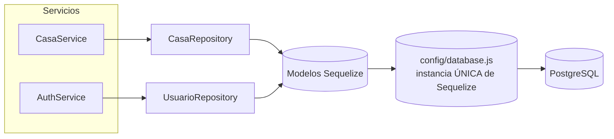

# 4. Programación (−5 pts)

> Parte de **Michelle** (backend y seguridad). Las secciones de vistas/Tailwind (Karla), base de datos y ORM (Erika) y PDF/correo (Alondra) las agrega cada responsable.

## 4.1 Estructura y capas (POO)

```
Petición HTTP → routes/ → middlewares/ → controllers/ (clases) → services/ (lógica) → repositories/ → models/ (Sequelize) → PostgreSQL
```

| Capa | Responsabilidad | Ejemplos |
|---|---|---|
| `routes/` | Declara URL y el orden de middlewares | `admin.js`, `api.js` |
| `middlewares/` | Autenticación, CSRF, límite de intentos, subida de archivos, cabeceras | `auth.js`, `csrf.js`, `loginLimiter.js`, `upload.js` |
| `controllers/` | **Clases**: traducen HTTP ↔ servicios (sin lógica de negocio) | `AuthController`, `AdminCasaController`, `ApiCasaController` |
| `services/` | Reglas de negocio y validaciones | `CasaService`, `AuthService`, `ImageService` |
| `repositories/` | Único lugar que consulta la BD | `CasaRepository`, `UsuarioRepository` |

**POO aplicada:** cada controlador y servicio es una clase con **inyección de dependencias por constructor** (`constructor(service = new CasaService())`), lo que permite sustituir dependencias en pruebas; los métodos de los controladores son *arrow functions* de clase para conservar `this` al usarse como manejadores de Express.

## 4.2 Patrones de diseño



- **Repository** (`CasaRepository`, `UsuarioRepository`): ningún controlador ni servicio habla con Sequelize; todo acceso a datos pasa por estas clases. Ventaja: si cambia la BD o el ORM solo cambian los repositorios, y los servicios se pueden probar con repositorios falsos.
- **Singleton** (`src/config/database.js`): Node cachea los módulos, así que `require('../config/database')` entrega siempre **la misma** conexión a PostgreSQL en toda la aplicación (un único *pool*).
- **Evidencia:** `src/repositories/*.js`, `src/config/database.js` y las pruebas `tests/*.test.js`, que ejercitan la capa completa contra PostgreSQL real.

## 4.3 Autenticación (zona pública y privada)

- Zona **pública**: sitio y `/admin/login`. Zona **privada**: todo lo demás bajo `/admin` (`requireAuth` → redirige al login) y la API protegida (`requireAuthApi` → `401` JSON).
- Contraseñas con **bcrypt** (10 rondas); nunca se guardan ni se registran en texto plano.
- `autenticar()` compara contra un hash de relleno aunque el correo no exista (no se puede averiguar qué correos existen por el tiempo de respuesta) y el mensaje es único: *"Correo o contraseña incorrectos"*.
- `session.regenerate()` al entrar (evita **fijación de sesión**); cookie `HttpOnly` + `SameSite=Lax` (+ `Secure` en producción).
- **Anti fuerza bruta:** 5 intentos fallidos por IP+correo → `429` durante 15 min (`loginLimiter.js`).
- **CSRF:** token por sesión (`_csrf`) obligatorio en todos los POST del admin (`csrf.js`); la API solo acepta `application/json` en POST/PUT (`415` en otro caso).
- Cabeceras `X-Content-Type-Options`, `X-Frame-Options`, `Referrer-Policy`; sin `X-Powered-By`; en producción el arranque **falla** si `SESSION_SECRET` es débil o el de ejemplo.
- Los errores 5xx no revelan SQL ni mensajes internos (ni en HTML ni en JSON).
- **Cambiar la contraseña del admin:** `NUEVA_PASSWORD='Clave-Segura-2026' npm run admin:password -- admin@multicasa.com` (mín. 10 caracteres, con letras y números). Además cambiar `ADMIN_PASSWORD` y `SESSION_SECRET` en el `.env`.

## 4.4 Altas, bajas y cambios (solo administradores)

Rutas `/admin/casas` (listado, nueva, editar, eliminar, quitar foto). Validaciones en `CasaService.validar()`:

| Campo | Regla |
|---|---|
| título, ciudad, estado | obligatorios; máx. 150 / 80 / 80 caracteres |
| precio | número > 0 y < 10 000 000 000 (cabe en `NUMERIC(12,2)`) |
| recámaras, baños | enteros de 0 a 99 |
| C.P. | opcional; 5 dígitos |
| estatus | `venta` o `vendida` (un valor inválido da error; antes se cambiaba en silencio) |
| latitud / longitud | rangos válidos y **ambas o ninguna** |
| fotos | JPG/PNG/WebP, ≤ 10 MB c/u, ≤ 8 por envío, deben ser imágenes reales |

Orden de la operación: **validar → procesar fotos (WebP + miniatura) → escribir en BD**. Si una foto es inválida no se guarda nada (todo o nada) y si la BD falla se borran los archivos generados. Los errores se muestran en el formulario con código `422`, conservando lo capturado.

## 4.5 API REST

Base: `/api`. Formato JSON. Colección de Postman lista para ejecutar: `docs/multicasa.postman_collection.json`.

| Método y ruta | Acceso | Respuestas |
|---|---|---|
| `GET /api/casas?q&precioMin&precioMax&recamaras&banos&pagina` | público | 200 |
| `GET /api/casas/:id` | público | 200 · 404 |
| `POST /api/casas` | admin | 201 · 401 · 415 · 422 |
| `PUT /api/casas/:id` | admin | 200 · 401 · 404 · 415 · 422 |
| `DELETE /api/casas/:id` | admin | 204 · 401 · 404 |
| `GET /api/estadisticas` | admin | 200 · 401 |

Cualquier otra ruta bajo `/api` → `404` JSON; JSON mal formado → `400`; cuerpo > 100 KB → `413`; error interno → `500` genérico. `PUT` reemplaza la casa completa (los campos omitidos toman su valor por defecto).

Para probar en Postman: importar la colección y ejecutarla con *Collection Runner* (usa las variables `adminEmail` y `adminPassword`; la sesión se guarda sola en la cookie).

## 4.6 Pruebas realizadas

Ejecutar con PostgreSQL encendido y una base **aparte** (las pruebas borran sus tablas): `createdb multicasa_test` y luego `npm test` (usa `DB_NAME_TEST`, por defecto `multicasa_test`; se niega a correr si el nombre no contiene "test").

| Suite | Pruebas | Qué cubre |
|---|---|---|
| `tests/auth.test.js` | 17 | login correcto/incorrecto, correo inexistente, entradas raras, CSRF, bloqueo por fuerza bruta, fijación de sesión, cookie, cabeceras, logout, bcrypt, cambio de contraseña, acceso sin sesión (GET y POST) |
| `tests/casas-admin.test.js` | 34 | alta/cambio/baja, fotos (WebP, principal, miniatura, borrado en disco), 15 validaciones, imagen corrupta/tipo/tamaño/cantidad, CSRF (incluido multipart externo), no filtrar errores internos |
| `tests/api.test.js` | 17 | GET/POST/PUT/DELETE/estadísticas, 401/404/415/413/422/400/500, filtros y caracteres especiales |
| **Total** | **68, todas pasan** | |
| Postman/Newman | 21 peticiones, 33 aserciones, todas pasan | códigos 200, 201, 204, 401, 404, 415, 422 |

### Defectos encontrados y corregidos

| # | Defecto (comprobado con una petición real) | Corrección |
|---|---|---|
| 1 | Imagen corrupta: la casa **se creaba** y luego respondía 500 (casa sin fotos) | Procesar fotos antes de escribir en BD; todo o nada; `422` |
| 2 | Tipo de archivo no permitido o archivo muy grande: página de error 500 | Errores de multer → `422` en el formulario |
| 3 | Título > 150 caracteres o precio ≥ 10¹⁰: error de PostgreSQL (500) | Validaciones de longitud y rango |
| 4 | Recámaras negativas o decimales aceptadas; estatus inválido se cambiaba a "venta" | Validación de enteros y de estatus |
| 5 | JSON mal formado y rutas `/api/...` inexistentes respondían HTML | Errores y 404 de la API siempre en JSON |
| 6 | `throw` dentro del callback de `session.regenerate` podía tumbar el servidor | Se pasa a `next(err)` |
| 7 | Sin CSRF, sin límite de intentos, errores 5xx con detalles internos | Sección 4.3 |
