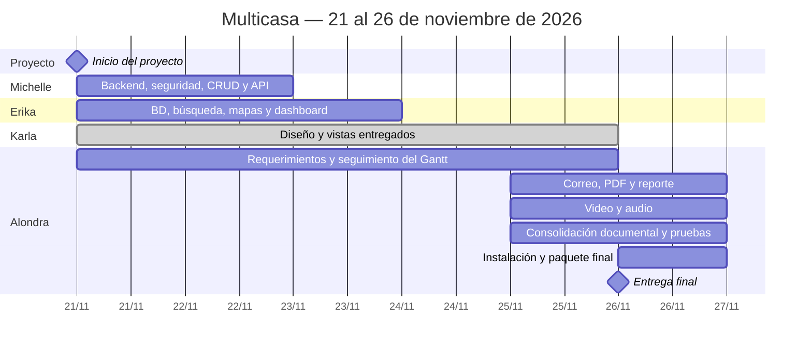

# 7. Diagrama de Gantt (−50 pts si no se entrega)

**Periodo del proyecto:** del 21 al 26 de noviembre de 2026.

**Fecha de corte:** 25 de noviembre de 2026.

**Entrega final:** 26 de noviembre de 2026.

El inicio y la entrega final fueron confirmados por Alondra. Michelle entregó primero y Erika después; Alondra confirmó que las tareas de Karla quedaron terminadas el 25 de noviembre. Las ventanas de trabajo siguientes son de planificación: no acreditan fechas individuales de inicio ni pruebas terminadas. El historial local registra la aportación de Michelle el 22 y la de Erika el 23.

## 7.1. Tareas y responsables

| Tarea | Responsable | Inicio planificado | Fin planificado | Estado al 25 de noviembre |
|---|---|---|---|---|
| Requerimientos y seguimiento del Gantt | Alondra, con aportaciones de todas | 21/11/2026 | 25/11/2026 | Gantt y análisis de requerimientos documentados; validación final pendiente |
| Diseño y maquetación según PSD; vistas y responsivo | Karla | 21/11/2026 | 25/11/2026 | Terminadas hoy según confirmación de Alondra; pendiente validación integral |
| Login, seguridad y CRUD administrativo | Michelle | 21/11/2026 | 22/11/2026 | Aportación entregada primero; pendiente de validación integral |
| API REST y documentación de backend | Michelle | 21/11/2026 | 22/11/2026 | Aportación entregada; resultados de pruebas documentados por Michelle |
| Modelos, base de datos y datos de ejemplo | Erika | 21/11/2026 | 23/11/2026 | Aportación entregada después de Michelle |
| Búsqueda, mapas, dashboard y documentación de BD | Erika | 21/11/2026 | 23/11/2026 | Aportación integrada en el historial local; pendiente de validación integral |
| Ficha PDF y reporte de casas con estatus | Alondra | 25/11/2026 | 26/11/2026 | Generación aislada comprobada con y sin foto; pendiente prueba desde el sitio con BD |
| Configurar y comprobar correo de contacto | Alondra; coordinación visual con Karla | 25/11/2026 | 26/11/2026 | Cuenta y destinatario configurados localmente; pendientes contraseña de aplicación y recepción real |
| Guion, grabación e integración de video y audio | Alondra | 25/11/2026 | 26/11/2026 | Guiones preparados; Alondra realizará las grabaciones |
| Consolidar los siete documentos | Alondra, con aportaciones de todas | 25/11/2026 | 26/11/2026 | En proceso; conservar aportaciones de Michelle y Erika |
| Pruebas integrales y capturas de evidencia | Alondra, con apoyo de todas | 25/11/2026 | 26/11/2026 | Pendientes de ejecución y registro |
| Instalación desde cero y preparación de entrega | Alondra | 26/11/2026 | 26/11/2026 | Pendientes validación en otra computadora y paquete final |

## 7.2. Diagrama de Gantt

Las barras representan las ventanas planificadas de trabajo. La tabla anterior indica el estado comprobado o reportado de cada entrega.

## 7.3. Seguimiento de commits

El proyecto inició el sábado 21. El domingo corresponde al **22 de noviembre**, el lunes al **23** y hoy al **miércoles 25**.

| Fecha | Seguimiento informado por Alondra | Verificación |
|---|---|---|
| Domingo 22/11/2026 | Dos commits reportados | Pendiente identificar ambos hashes y ramas |
| Lunes 23/11/2026 | Dos commits reportados | Pendiente identificar ambos hashes y ramas |
| Miércoles 25/11/2026 | Dos commits faltantes, previstos para hoy | Pendientes; esta actualización no crea commits |

El historial local consultado contiene un commit inicial del 21, una aportación de backend del 22 y una aportación de Erika más su merge del 23. Esto no permite acreditar todavía los dos commits reportados para el domingo; pueden corresponder a otras ramas o a información aún no integrada.

## 7.4. Dependencias y cierre

- Karla: tareas terminadas el 25 según Alondra; integrar evidencias y documentación sin alterar sus archivos.
- Michelle y Erika: conservar sus aportaciones y consolidarlas con los documentos restantes.
- Erika: disponer de casas con fotos para las pruebas de PDF; incluir también casos sin fotos.
- Alondra: configurar SMTP, verificar recepción, integrar multimedia y registrar evidencias reales.
- Cierre el 26: siete documentos completos, Gantt entregado, correo recibido, PDF generados, video y audio reproducibles e instalación desde cero comprobada. Ninguno de estos criterios se considera cumplido únicamente por tener una tarea calendarizada.
